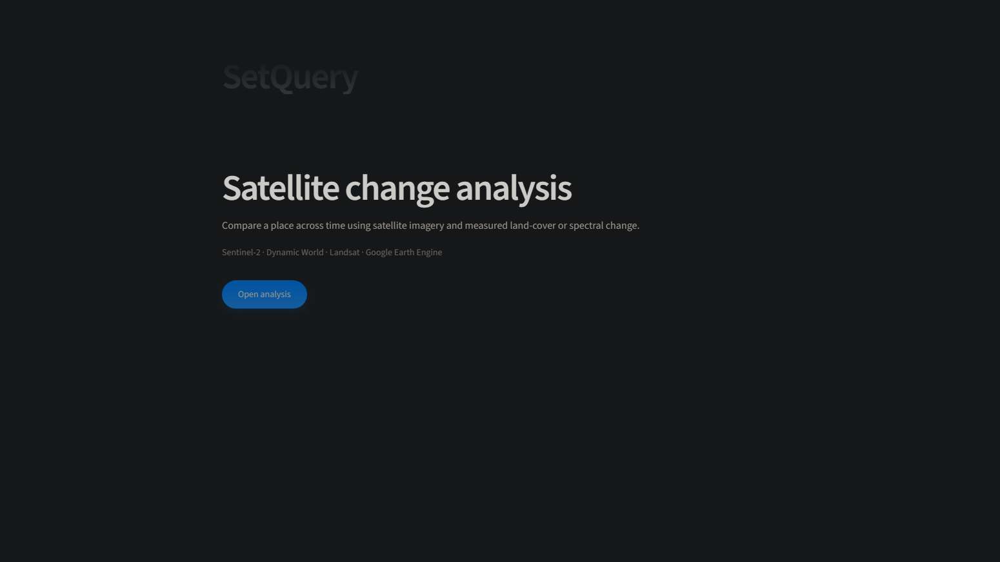
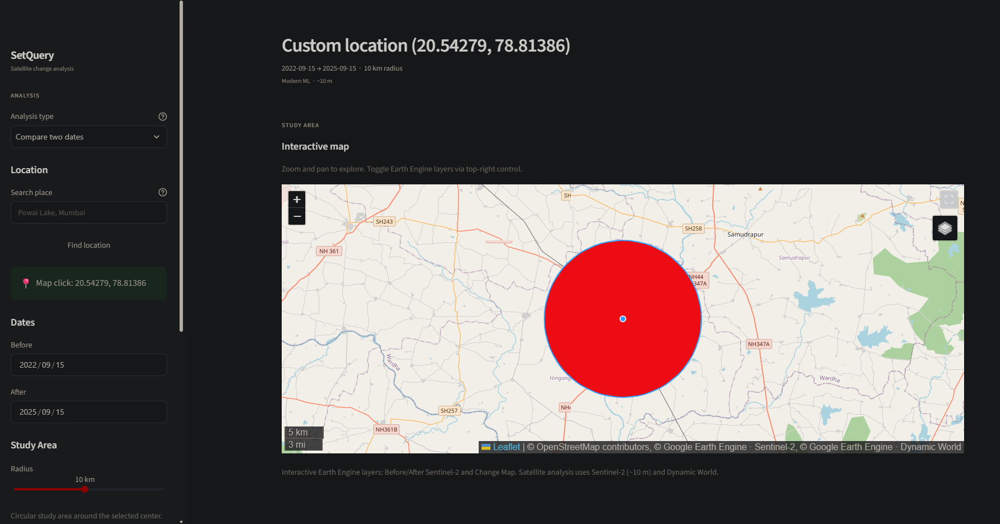
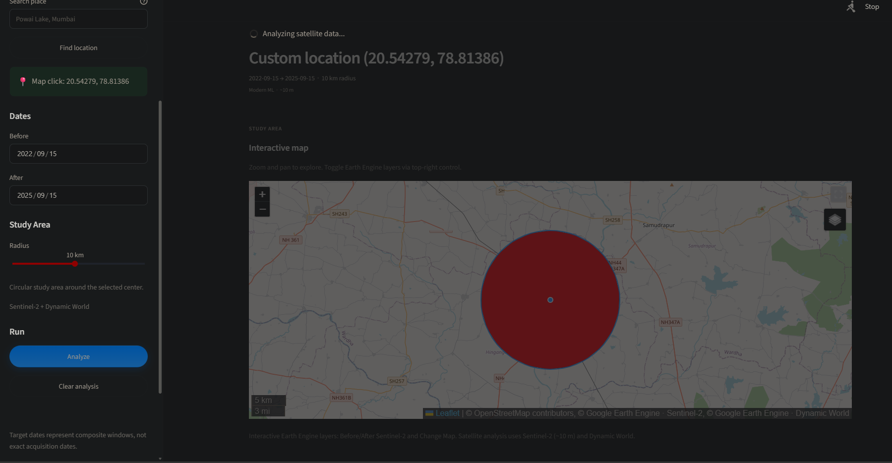
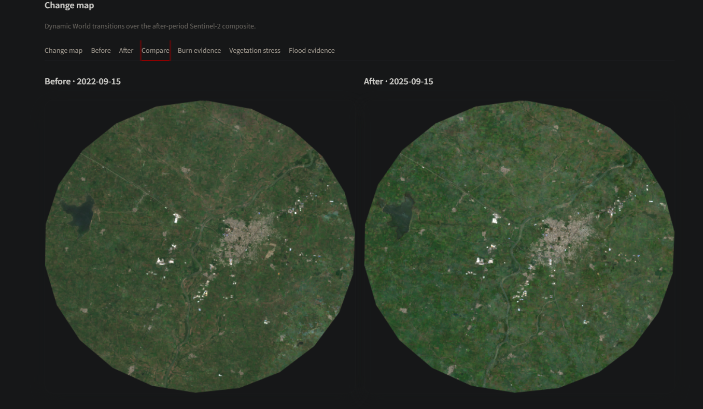
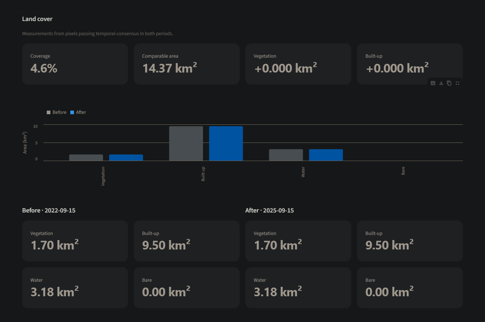
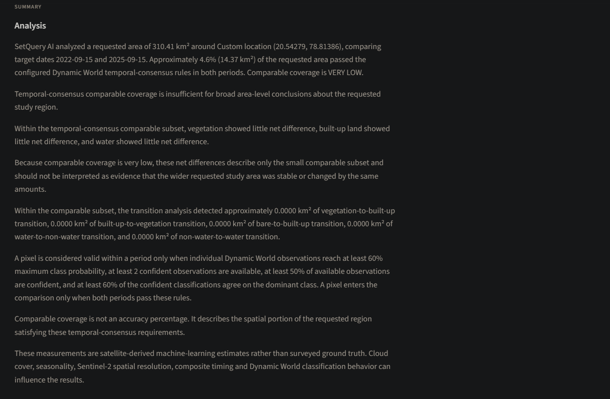
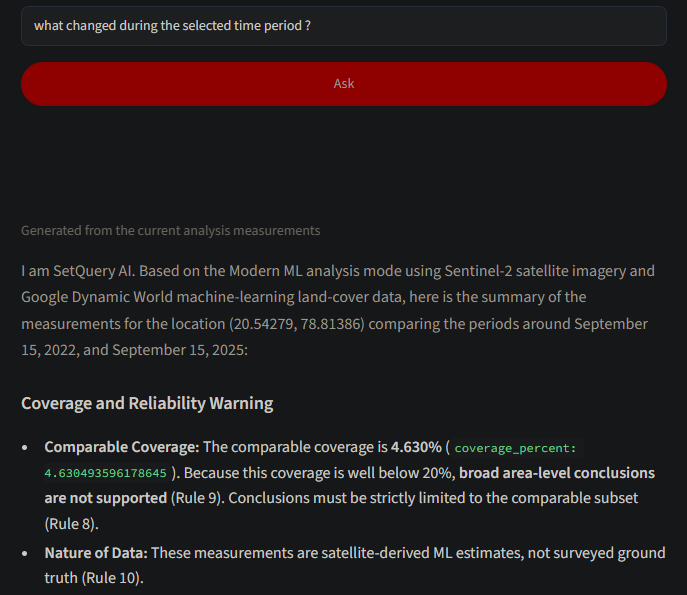

# SetQuery AI

Satellite-based change detection and grounded geospatial analysis.

[](https://python.org)
[](https://streamlit.io)
[](https://earthengine.google.com)
[](LICENSE)



---

## Overview

SetQuery AI compares any location on Earth across two time periods using satellite imagery, machine learning land-cover classification, and AI-assisted analysis. It is built for quick, area-level change detection without requiring GIS expertise — search a place, pick two dates, and get a structured breakdown of what changed.

The platform combines Sentinel-2 and Landsat imagery with Google's Dynamic World classifier, and layers an AI question-answering interface on top of the measured data so users can ask natural-language questions and get answers grounded in actual pixel statistics, not guesses.



**Highlights**

- Search by place name or click directly on the map to set a location
- Dual-sensor support: Sentinel-2 (10m) for modern analysis, Landsat (30m) for historical analysis before 2017
- Automatic mode switching based on the selected date range
- Change detection across five transition classes (vegetation loss, urban expansion, water changes, etc.)
- Optional on-demand modules for burn severity, vegetation stress, and flood evidence
- AI-grounded Q&A with a deterministic fallback when the LLM is unavailable
- Optimized pipeline — full analysis typically completes in under 5 seconds

---

## Features

| Feature | Description |
|---|---|
| Modern Analysis | Sentinel-2 SR + Dynamic World classification (2017–present, ~10m resolution) |
| Historical Analysis | Landsat-derived spectral indices for dates before 2017 (~30m resolution) |
| Interactive Map | Live Earth Engine tile layers with pan/zoom support |
| Click-to-Select | Set the analysis center by clicking anywhere on the map |
| Change Detection | Five tracked land-cover transitions between the two dates |
| Burn Evidence | NBR/dNBR-based burn severity, loaded on demand |
| Vegetation Stress | NDVI-based change analysis, loaded on demand |
| Flood Evidence | Sentinel-1 SAR backscatter change, loaded on demand |
| Trend Analysis | Multi-period land-cover composition over a longer timeline |
| AI Q&A | Natural-language queries answered using the actual computed statistics |

---

## Quick Start

### Prerequisites

- Python 3.10 or later
- A Google Earth Engine account (free for non-commercial use)
- A Google Gemini API key (only required for the AI Q&A feature)

### Installation

```bash
git clone https://github.com/codewithabuzar/SetQuery-AI.git
cd SetQuery-AI

python -m venv venv

# Windows
.\venv\Scripts\activate

# macOS / Linux
source venv/bin/activate

pip install -r requirements.txt
```

### Environment Variables

Create a `.env` file in the project root:

```env
# Google Earth Engine project ID (optional if using default auth)
GOOGLE_PROJECT_ID=your-project-id

# Google Gemini API key, used for AI-powered Q&A
GEMINI_API_KEY=your-api-key
```

A template is provided in `.env.example` — copy it and fill in your own keys:

```bash
cp .env.example .env
```

### Authenticate Earth Engine

```bash
earthengine authenticate
```

This opens a browser window to authorize access to your Earth Engine account.

### Run the App

```bash
streamlit run app.py
```

The app opens automatically at `http://localhost:8501`.

---

## Usage

### 1. Select a Location

You can either search for a place by name using the sidebar, or click directly on the map to drop a pin. Both methods set the analysis center.

### 2. Configure the Comparison

| Parameter | Description | Constraints |
|---|---|---|
| Before Date | Start of the comparison window | Any valid date (pre-2017 triggers historical mode) |
| After Date | End of the comparison window | Must be at least 90 days after the Before date |
| Radius | Size of the study area | 1–20 km |

The interactive map supports live Earth Engine tile layers, which can be toggled from the layer control in the top-right corner:



### 3. Run the Analysis

Click **Analyze**. Processing typically takes 4–10 seconds depending on the radius. The result includes an interactive map, land-cover metrics, before/after imagery, and a change detection overlay.



### 4. Review the Results

| Tab | Content |
|---|---|
| Change Map | Visual overlay of land-cover transitions |
| Before | Satellite composite for the earlier date |
| After | Satellite composite for the later date |
| Compare | Side-by-side view of both periods |
| Burn Evidence | Spectral burn severity (loads on request) |
| Vegetation Stress | NDVI-based stress indicators (loads on request) |
| Flood Evidence | SAR-based flood indicators (loads on request) |

Land-cover metrics are computed only from pixels that pass temporal-consensus validation in both periods:



Each analysis also generates a deterministic, plain-language summary of the measurements:



### 5. Ask Questions

Use the **Ask SetQuery AI** panel to ask questions in plain language, such as "how much vegetation was lost?" Answers are generated using the underlying measurements, with a deterministic summary as a fallback if the LLM is unavailable.



---

## Methodology

### Analysis Modes

| Mode | Trigger | Sensors | Resolution | Output |
|---|---|---|---|---|
| Modern | Both dates ≥ 2017-01-01 | Sentinel-2 + Dynamic World | ~10m | Land-cover classes and transitions |
| Historical | Either date < 2017-01-01 | Landsat 5/7/8 | ~30m | Spectral indices (NDVI, MNDWI, NDBI) |

### Temporal Consensus (Modern Mode)

Each target date is treated as the center of a ±45-day composite window rather than a single acquisition. For every pixel within that window:

**Per-observation processing**
- Extract the nine Dynamic World probability bands
- Take the maximum probability as a confidence score
- Assign the class with the highest probability (argmax)
- Flag the observation as confident if its score is ≥ 0.60

**Temporal aggregation**
- Count total available observations
- Count confident observations
- Determine the modal (most frequent) class
- Compute agreement with the modal class across observations

**Validity thresholds** — a pixel is considered valid for a given period only if:
- At least 2 observations are available
- At least 2 are confident
- Confident observations make up ≥ 50% of the total
- Agreement with the modal class is ≥ 60%

A pixel is included in the comparison only if it is valid for *both* periods. The resulting coverage percentage reflects the share of the study area that could be reliably compared — not classification accuracy.

### Land-Cover Classes

| Class | Underlying Dynamic World Classes |
|---|---|
| Water | 0 (water) |
| Vegetation | 1–5 (trees, grass, flooded vegetation, crops, shrub/scrub) |
| Built | 6 (built-up) |
| Bare | 7 (bare ground) |

### Tracked Transitions

- Vegetation → Built
- Built → Vegetation
- Bare → Built
- Non-water → Water
- Water → Non-water

---

## Performance

The analysis pipeline was optimized significantly from its initial implementation:

| Stage | Time | Change |
|---|---|---|
| Baseline | 69s | — |
| After deferring supplementary modules | 9s | 87% faster |
| After reducing thumbnail resolution | 4s | 55% faster further |
| After combining Earth Engine requests | ~4s | ~30% additional reduction |
| **Total improvement** | **69s → ~4s** | **~94% faster** |

**Key changes:**

- `prepare_modern_analysis()` builds the Earth Engine collections once and reuses them, instead of rebuilding per request
- Four separate collection counts were merged into a single `.getInfo()` call
- Statistics and area calculations were combined into one request
- Burn, vegetation stress, and flood modules were moved out of the blocking critical path and made on-demand
- Thumbnail resolution was reduced from 700px to 400px to speed up rendering without a noticeable visual loss

---

## Project Structure

```
SetQuery-AI/
├── app.py                          # Main Streamlit entry point
├── app_components/                 # Application orchestration and result views
│   ├── __init__.py               # Package initialization
│   ├── sidebar.py                # Sidebar controls and inputs
│   ├── workspace.py              # Empty workspace and map selection
│   ├── analysis_runner.py        # Modern, historical, and trend execution
│   ├── trend_results.py          # Trend charts and measurements
│   └── comparison_results.py     # Modern and historical result rendering
├── ui/
│   ├── __init__.py
│   ├── state.py                    # Session state management
│   ├── helpers.py                  # Shared UI helper functions
│   ├── location.py                 # Geocoding and location search
│   ├── map.py                      # Folium map construction
│   ├── charts.py                   # Altair chart components
│   └── fragments.py                # On-demand analysis tabs
├── assets/
│   └── style.css
├── docs/
│   └── images/                     # README screenshots
├── analysis/                        # Modern analysis (Sentinel-2 + Dynamic World)
│   ├── __init__.py                # Backward-compatible exports
│   ├── config.py                  # Earth Engine configuration and constants
│   ├── errors.py                   # Custom analysis exceptions
│   ├── validation.py              # Input and date validation
│   ├── ee_helpers.py              # Shared Earth Engine utilities
│   ├── collections.py             # Dynamic World and Sentinel-2 collections
│   ├── consensus.py               # Temporal consensus classification
│   ├── context.py                 # Shared Modern analysis context
│   ├── statistics.py              # Land-cover statistics and transitions
│   ├── imagery.py                 # Satellite previews and change maps
│   └── compat.py                  # Backward-compatible analysis functions
├── analysis_router.py              # Routes requests to the correct analysis mode
├── historical_analysis.py          # Landsat-based historical analysis
├── burn_analysis.py                # NBR/dNBR burn severity
├── flood_analysis.py               # Sentinel-1 SAR flood detection
├── vegetation_stress_analysis.py   # NDVI-based vegetation stress
├── trend_analysis.py                # Multi-period trend analysis
├── report.py                       # Deterministic summary (modern mode)
├── historical_report.py            # Deterministic summary (historical mode)
├── query.py                        # Local fallback Q&A logic
├── llm.py                          # Gemini integration
├── requirements.txt
├── .env                             # Environment variables (not committed)
├── .env.example                    # Environment variable template
├── .gitignore
└── README.md
```

---

## Testing

A few reference scenarios used during development:

| Location | Before | After | Expected Result |
|---|---|---|---|
| IIT Patna | 2022-09-15 | 2025-09-15 | Visible built-up expansion |
| Powai Lake, Mumbai | 2020-01-01 | 2024-01-01 | Stable water body |
| Rural area | 2018-06-01 | 2023-06-01 | Seasonal vegetation variation |

**Validation rules enforced by the app:**

- Coverage of 40% or higher is treated as moderate confidence or better
- Date separation must be at least 90 days
- Future dates are not allowed
- Radius must be between 1 and 20 km

---

## Limitations

| Limitation | Notes |
|---|---|
| Coverage is not accuracy | A high coverage percentage means enough comparable data was available — it does not guarantee the classification itself is correct |
| Composite, not instantaneous | Each date represents a ±45-day window, not a single satellite pass |
| Circular area only | The tool uses a point and radius, not administrative or parcel boundaries |
| Area-level, not property-level | Not designed for precise, individual-plot analysis |
| No ground truth | All results are derived from satellite imagery, not field surveys |
| Cloud cover sensitivity | Persistent cloud cover can reduce the amount of usable, comparable data |

---

## Tech Stack

| Layer | Technology |
|---|---|
| Frontend | Streamlit, Altair, Folium |
| Backend | Python 3.10+ |
| Geospatial Processing | Google Earth Engine, GeoPy |
| Machine Learning | Google Dynamic World V1 |
| AI | Google Gemini |
| Satellite Sources | Sentinel-2 SR, Landsat 5/7/8, Sentinel-1 SAR |
| Mapping | OpenStreetMap, Folium |

---

## Contributing

Contributions are welcome.

1. Fork the repository
2. Create a feature branch: `git checkout -b feature/your-feature`
3. Commit your changes: `git commit -m "Add your feature"`
4. Push the branch: `git push origin feature/your-feature`
5. Open a pull request

---

## License

This project is licensed under the MIT License. See [LICENSE](LICENSE) for details.

---

## Contact

**Developer:** Mohd Abuzar
**GitHub:** [@codewithabuzar](https://github.com/codewithabuzar)
**Earth Engine Project:** optimum-reactor-510109-b5

---

## Acknowledgments

- Google Earth Engine — satellite data platform
- Google Dynamic World — land-cover classification model
- Streamlit — application framework
- OpenStreetMap — base map data
- Nominatim — geocoding service

---

<p align="center">
  SetQuery AI — Satellite Change Detection & Grounded Analysis
</p>